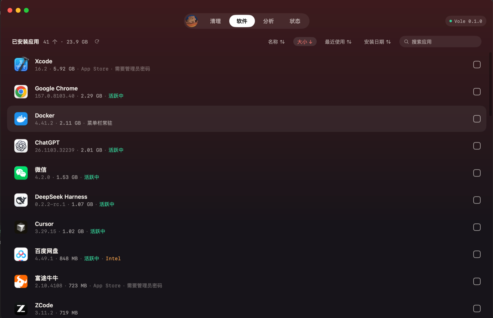
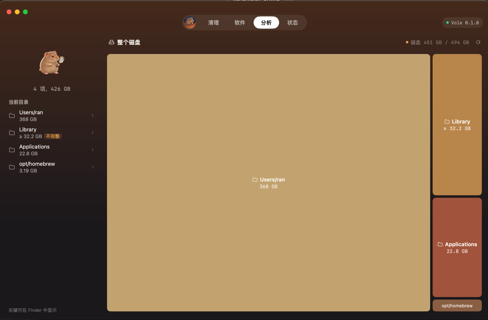
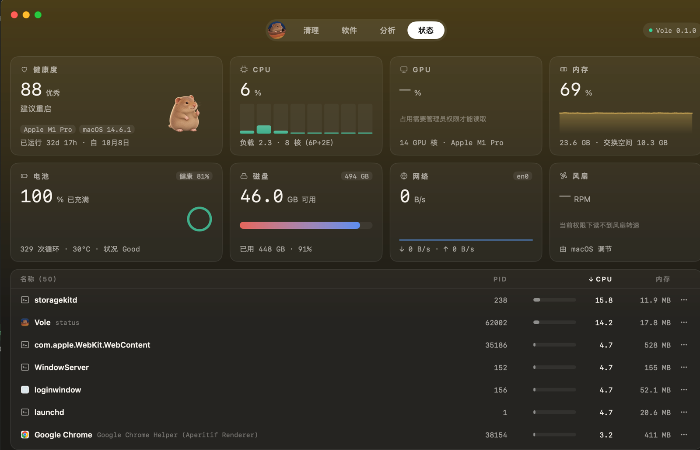

<p align="center">
  
</p>

<h1 align="center">Vole</h1>

<p align="center">
  A native macOS app to see what fills your disk, clean caches safely, uninstall apps completely, and keep an eye on your system.
</p>

<p align="center">
  English · <a href="README.zh-CN.md">简体中文</a>
</p>

---

Vole is named after the field vole, a small cousin of the mole that also digs through soil. It is a desktop app built on the open-source [Mole](https://github.com/tw93/Mole) CLI by tw93: Vole bundles Mole's analyzer and system monitor, and ports Mole's cleanup and uninstall rules to Go with a review-before-delete interface.

## Features

- **Analyze**: a treemap of your disk. Drill into any folder, see the largest files, and spot folders that are safe to clean. Large folders appear one by one as they finish scanning.
- **Clean**: finds caches and leftovers in 9 categories: app caches, system caches, logs, developer caches, Xcode and simulators, AI tools, browsers, messaging apps, and the Trash. You review every item before anything is deleted. Items belonging to running apps are skipped, and every path is checked again right before deletion.
- **Apps**: lists installed apps with size, last use, and status (running, menu bar, Intel). Uninstalls an app together with its related files. Caches and logs are selected by default; personal data (settings, chat history, VM images) is never selected unless you choose it. Everything goes to the Trash.
- **Status**: live CPU, memory, disk, network, and battery, plus a process list where you can sort, pin, reveal in Finder, quit, or force quit processes.
- **Menu bar panel**: closing the main window keeps Vole in the menu bar. Click the vole icon to see health, CPU, memory, disk, network, battery, and top processes at a glance. Data is collected only while the panel is open. Optional: open at login.

## Screenshots

| Clean | Apps |
|---|---|
|  |  |
| **Analyze** | **Status** |
|  |  |

## Requirements

- A Mac with Apple silicon (M1 or later). Intel Macs are not supported yet.
- macOS 12 or later (tested on macOS 14).
- The interface is available in Simplified Chinese and Korean. Vole follows the system's preferred languages (System Settings › General › Language & Region) and falls back to Simplified Chinese. To choose one explicitly, set `VOLE_LANG=zh` or `VOLE_LANG=ko`.

## Install

1. Download the latest `.dmg` from [Releases](https://github.com/hellozhangran/vole/releases).
2. Open the `.dmg` and drag **Vole** into **Applications**.
3. **First launch.** Vole is not notarized by Apple yet, so macOS blocks it the first time:
   - **macOS 15 and later**: open Vole once and dismiss the warning. Then go to **System Settings › Privacy & Security**, scroll down, and click **Open Anyway** next to the message about Vole.
   - **macOS 14 and earlier**: right-click Vole in Applications, choose **Open**, then click **Open** again.
   - Or, in Terminal: `xattr -dr com.apple.quarantine /Applications/Vole.app`
4. **Grant Full Disk Access (recommended).** Without it, some folders such as the Trash, Mail, and Safari data cannot be measured or cleaned. Go to **System Settings › Privacy & Security › Full Disk Access**, click **+**, add **Vole**, and restart Vole. Vole also shows a shortcut to this page when access is missing.
   - After updating to a new version of Vole, remove the old Vole entry from the list and add it again.

Nothing else is needed. The Mole components Vole relies on are bundled inside the app.

## Safety

- **Nothing is deleted without your confirmation.** Scanning is read-only. Only the items you check are removed, after a confirmation dialog that lists them.
- **Caches** that apps rebuild automatically are deleted permanently, so the space is freed right away. **Your own content** and **uninstalled apps** go to the Trash, so you can restore them.
- Cleanup only touches your home folder. Uninstall also moves the app itself out of Applications. System-critical paths and data of protected apps are never touched, every path is verified again right before deletion, and symlinks are never followed.
- Every cleanup and uninstall is logged to `~/Library/Logs/Vole/operations.log`.
- Vole does not collect or send any data. It works entirely offline.

## Build from source

You need Go 1.27 or later and the Xcode Command Line Tools.

```sh
git clone https://github.com/hellozhangran/vole.git
cd vole
scripts/package.sh
```

The source code of Mole that Vole depends on is included unmodified in `third_party/mole/` (pinned commit, see [THIRD_PARTY_NOTICES.md](THIRD_PARTY_NOTICES.md)). `scripts/package.sh` builds Mole's `analyze` and `status` tools from it, then builds, signs (ad hoc), and packages Vole. Go modules are downloaded as usual. The app and the `.dmg` are written to `build/darwin-arm64/`.

To run a development build instead, use `scripts/dev.sh`.

## Credits

- [Mole](https://github.com/tw93/Mole) by tw93: Vole bundles Mole's `analyze` and `status` tools unmodified, and its cleanup and uninstall logic is ported from Mole's source. See [THIRD_PARTY_NOTICES.md](THIRD_PARTY_NOTICES.md) for details and the exact commit.
- [mygo](https://github.com/egoist/mygo): the Go desktop framework Vole's interface is built with.

Vole is an independent project and is not affiliated with the Mole app.

## License

Vole is released under the [GNU General Public License v3.0](LICENSE).
