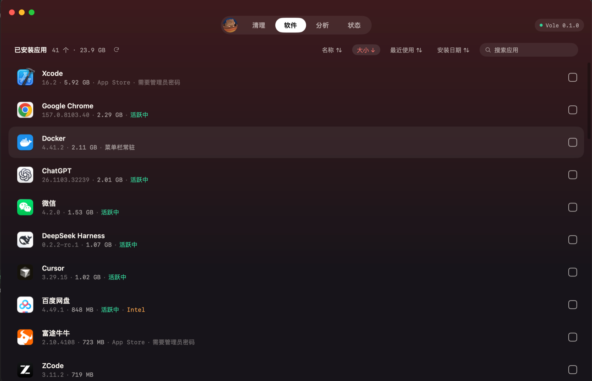
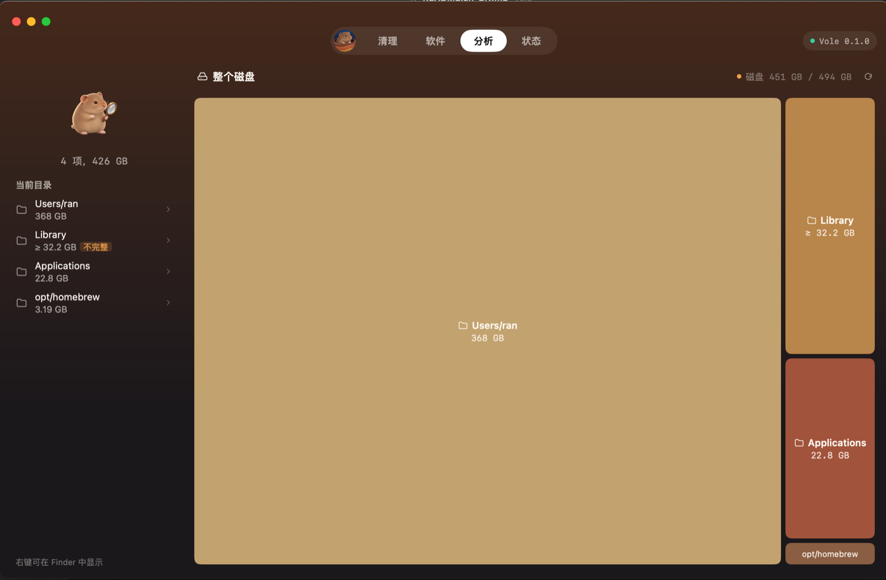
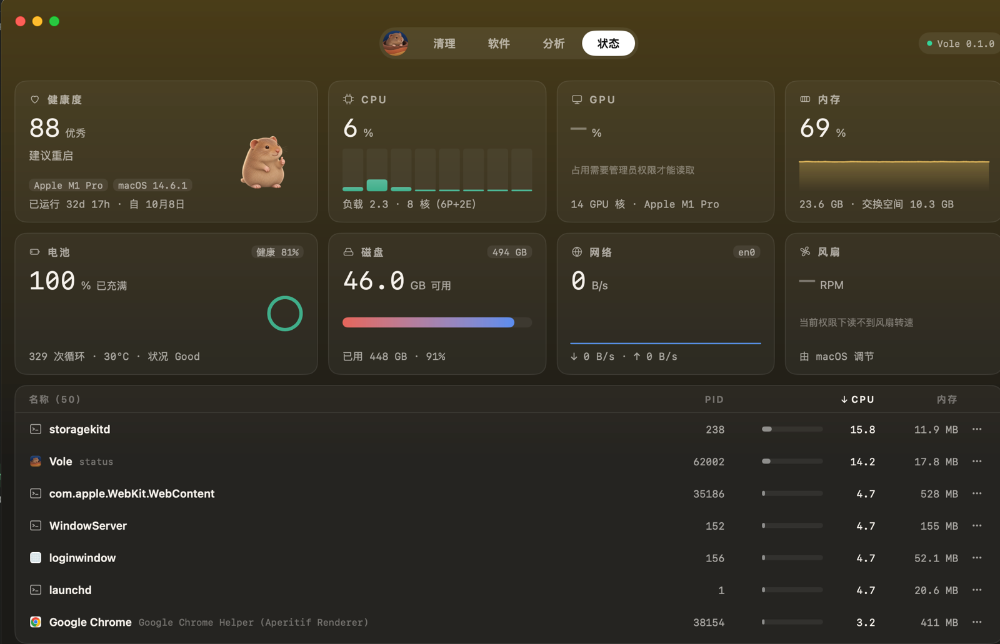

<p align="center">
  
</p>

<h1 align="center">Vole</h1>

<p align="center">
  一个原生 macOS app：看清磁盘被什么占满、安全地清理缓存、把 app 卸干净，再顺手看看系统状态。
</p>

<p align="center">
  <a href="README.md">English</a> · 简体中文
</p>

---

Vole 的名字取自田鼠，它是鼹鼠（mole）的近亲，同样爱挖洞翻土。Vole 基于 tw93 的开源命令行工具 [Mole](https://github.com/tw93/Mole)：打包了 Mole 的磁盘分析和系统监控程序，并把 Mole 的清理、卸载规则移植成 Go，配上「先查看、再确认删除」的界面。

## 功能

- **分析**：用矩形树图展示磁盘占用。可以点进任意目录，查看最大的文件，找出可以安全清理的目录。大目录扫完一个就显示一个，不用等全部扫完。
- **清理**：从 9 类里找缓存和残留：App 缓存、系统缓存、日志、开发者缓存、Xcode 与模拟器、AI 工具、浏览器、通讯工具、废纸篓。每一项都由你确认后才会删除；正在运行的 app 的缓存会跳过，删除前还会再校验一次路径。
- **软件**：列出已安装的 app，显示大小、上次使用时间和状态（运行中、菜单栏常驻、Intel 架构）。卸载时连同关联文件一起清理：缓存和日志默认勾选，个人数据（设置、聊天记录、虚拟机镜像等）只有你自己勾选才会删。所有内容都移到废纸篓。
- **状态**：实时显示 CPU、内存、磁盘、网络、电池，还有进程列表，可以排序、固定、在 Finder 中显示、退出或强制退出进程。
- **菜单栏面板**：关掉主窗口后，Vole 会常驻菜单栏。点一下田鼠图标，就能看到健康度、CPU、内存、磁盘、网络、电池和高占用进程。只在面板打开时才采集数据。可以设置开机时启动。

## 截图

| 清理 | 软件 |
|---|---|
|  |  |
| **分析** | **状态** |
|  |  |

## 系统要求

- Apple 芯片（M1 及以后）的 Mac。暂不支持 Intel 芯片的 Mac。
- macOS 12 及以上（在 macOS 14 上测试过）。
- 界面支持简体中文和韩语：按系统首选语言（系统设置 › 通用 › 语言与地区）选择，都不匹配时用简体中文。也可以用环境变量 `VOLE_LANG=zh` 或 `VOLE_LANG=ko` 指定。

## 安装

1. 从 [Releases](https://github.com/hellozhangran/vole/releases) 下载最新的 `.dmg`。
2. 打开 `.dmg`，把 **Vole** 拖进「应用程序」。
3. **第一次打开**：Vole 还没有经过 Apple 公证，第一次打开会被系统拦下：
   - **macOS 15 及以上**：先打开一次 Vole，关掉提示；然后到「系统设置 › 隐私与安全性」，拉到下面，在关于 Vole 的提示旁点「仍要打开」。
   - **macOS 14 及以下**：在「应用程序」里右键点 Vole，选「打开」，再点一次「打开」。
   - 也可以在终端里执行：`xattr -dr com.apple.quarantine /Applications/Vole.app`
4. **授予完全磁盘访问（建议）**：没有这个权限，废纸篓、邮件、Safari 数据等目录无法统计和清理。到「系统设置 › 隐私与安全性 › 完全磁盘访问」，点「+」添加 **Vole**，然后重新打开 Vole。缺少权限时，Vole 里也会显示前往设置的入口。
   - 更新到新版本的 Vole 后，需要在列表里删掉旧的 Vole，再重新添加一次。

不需要另外安装任何东西，Vole 用到的 Mole 组件都已经打包在 app 里。

## 安全

- **没有你的确认，什么都不会删。** 扫描全程只读；只有你勾选的项目，在确认框里列清楚之后才会删除。
- **会自动重建的缓存**直接永久删除，空间马上释放；**你自己的内容**和**卸载的 app** 移到废纸篓，可以找回。
- 清理只动你的用户目录；卸载时还会把 app 本体从「应用程序」里移走。系统关键路径和受保护 app 的数据一律不碰，每个路径删除前都会再校验一次，绝不跟随符号链接。
- 每一次清理和卸载都记录在 `~/Library/Logs/Vole/operations.log`。
- Vole 不收集、不上传任何数据，完全离线运行。

## 从源码构建

需要 Go 1.27 或更高版本，以及 Xcode 命令行工具。

```sh
git clone https://github.com/hellozhangran/vole.git
cd vole
scripts/package.sh
```

Vole 依赖的 Mole 源码已经原样放在 `third_party/mole/`（固定的 commit 见 [THIRD_PARTY_NOTICES.md](THIRD_PARTY_NOTICES.md)）。`scripts/package.sh` 会用它编译出 Mole 的 `analyze` 和 `status` 程序，再构建、签名（ad-hoc）并打包 Vole；Go 依赖照常自动下载。app 和 `.dmg` 输出在 `build/darwin-arm64/`。

如果只想运行开发版，用 `scripts/dev.sh`。

## 致谢

- tw93 的 [Mole](https://github.com/tw93/Mole)：Vole 原样打包了 Mole 的 `analyze` 和 `status` 程序，清理和卸载逻辑移植自 Mole 的源码。详情和对应的 commit 见 [THIRD_PARTY_NOTICES.md](THIRD_PARTY_NOTICES.md)。
- [mygo](https://github.com/egoist/mygo)：Vole 界面所用的 Go 桌面框架。

Vole 是独立项目，与 Mole app 没有关联。

## 许可证

Vole 以 [GNU General Public License v3.0](LICENSE) 发布。
